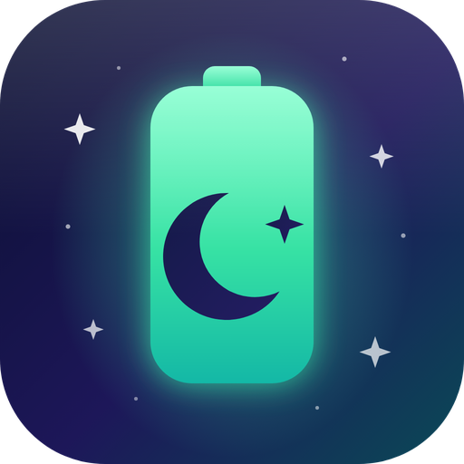
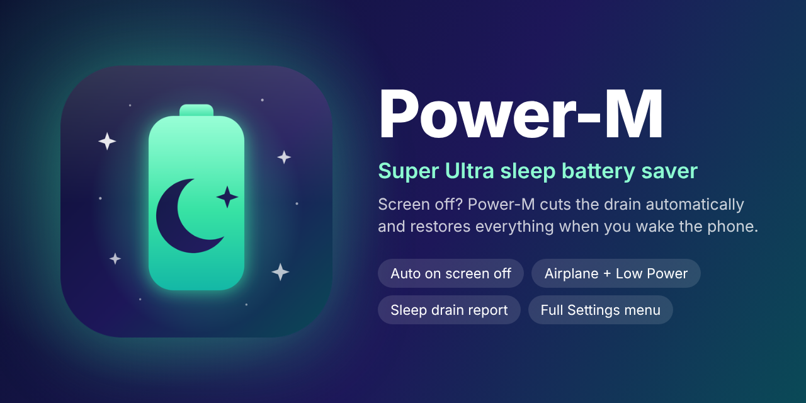

<p align="center">
  
</p>

<h1 align="center">Power-M</h1>

<p align="center"><b>Super Ultra sleep battery saver for jailbroken iPhones.</b><br>
Screen off? Power-M automatically cuts battery drain, and puts everything back when you wake the phone.</p>

<p align="center"></p>

## Why

Leave your iPhone alone for an hour or two with the screen off and the battery should barely move. On many phones it keeps falling (20, 19, 18...) because Wi-Fi, Bluetooth, cellular data, location and background apps keep working while you sleep. Power-M switches those off the moment the screen turns off, then restores them when you come back.

## Features

**Automatic sleep mode**
- Starts by itself when the screen turns off. No button to press.
- Restores *only what it changed* when you wake the phone. If Wi-Fi was already off, it stays off.
- Survives a respring or crash: saved state is put back on the next unlock.

**What it switches off while the screen is off** (each one is optional)
- Low Power Mode
- Airplane Mode (the biggest saver: cellular, Wi-Fi and Bluetooth off)
- Wi-Fi and Bluetooth individually (for when you want calls and messages to keep working)
- Location Services
- Background apps (closed, except Phone, FaceTime and Settings)

**Smart conditions**
- Skip while charging.
- Skip while music or video is playing.
- Schedule: all day, or night hours only (you choose start and end).
- Start delay from "Immediately" to 1 minute.
- Wake delay: a quick glance at the lock screen does not switch everything back on. Unlocking restores at once.

**Sleep report: see the real result**
- Logs battery % when the screen turns off and when it turns on again.
- Shows last sleep, battery change, and the average drain per hour with Power-M on versus off.

**Full control in Settings > Power-M**
- Master switch, three one-tap presets (Super Ultra, Deep Sleep, Light), a test button, a restore button and a respring button.

## Presets

| Preset | What it does | Calls and messages while asleep |
| --- | --- | --- |
| Super Ultra | Everything off: Airplane Mode, Low Power Mode, Location, closes apps | Blocked until you wake the phone |
| Deep Sleep | Low Power Mode, Wi-Fi and Bluetooth off, closes apps, cellular stays on | Work |
| Light | Low Power Mode only | Work |

Alarms still ring in every mode.

## Install

Download the `.deb` from the latest successful run under the **Actions** tab (artifact `Power-M-deb`):

| Jailbreak | Package |
| --- | --- |
| checkra1n, unc0ver, Odyssey (rootful) | `..._iphoneos-arm.deb` |
| palera1n, Dopamine (rootless) | `..._iphoneos-arm64.deb` |

Install with Filza, Sileo or Zebra, then respring. Requires `mobilesubstrate` (or ElleKit) and `preferenceloader`. Built for iOS 12 and later on arm64 devices.

## Honest notes

- Power-M cannot make the battery *never* move. It removes the things a jailbroken phone does while asleep, but an old battery, a weak signal or another tweak waking the phone can still cost a percent or two. The Sleep Report shows what actually happened.
- Airplane Mode means no calls, messages or notifications until you wake the phone. Use Deep Sleep or the night schedule if you need to stay reachable.
- Closing background apps can lose unsaved work in apps that do not save their state. Turn it off if that bothers you.
- If saving does not start, set **Start After** to *Immediately*: iOS can fall asleep before a longer delay finishes.
- The system calls Power-M uses are private iOS APIs, so a switch may do nothing on some iOS versions. Everything is guarded and fails safely.

## Build

Needs [Theos](https://theos.dev). GitHub Actions builds both packages on every push.

```sh
make package FINALPACKAGE=1                                # rootful
make package FINALPACKAGE=1 THEOS_PACKAGE_SCHEME=rootless  # rootless
```

## Icon

`assets/icon.svg` is the source for the icon: a glowing battery with a crescent moon, for a phone that sleeps without draining.
